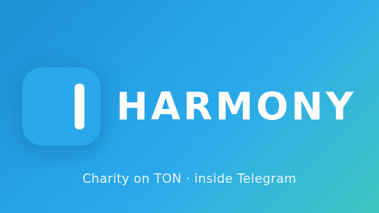
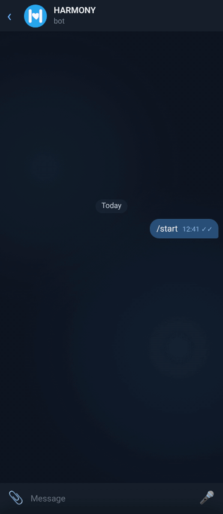
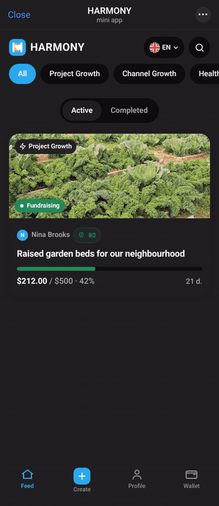
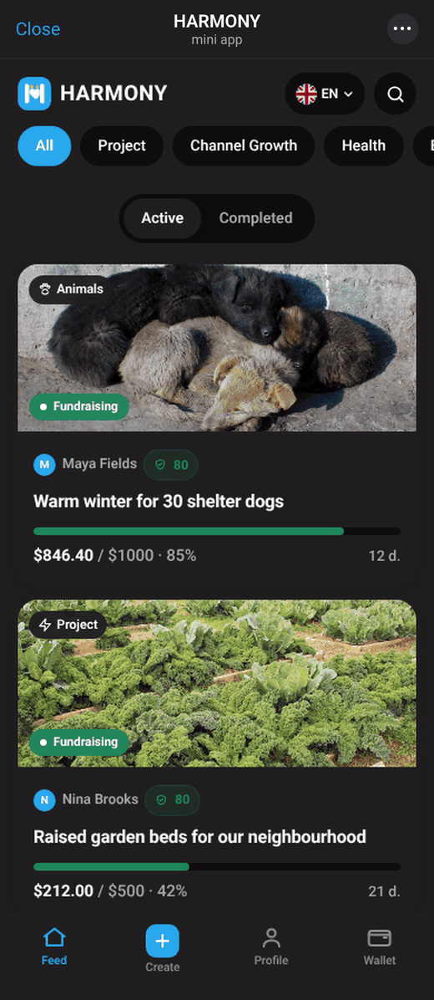

<div align="center">



### Charity inside Telegram. Your donation goes to a smart contract — not to us.

[**▶ Open HARMONY in Telegram**](https://t.me/Gram_Harmony_Bot?startapp) &nbsp;·&nbsp; [**💙 Support HARMONY development**](https://t.me/Gram_Harmony_Bot?start=c_749ba7f4-3a2a-4da0-a97d-424ffa3e5872)

[](https://tonviewer.com/EQBd7vdHMquB_q5d5nRAzmqQ7ZGSVlHzxbAmWgllAfpRrXVR)
[](contracts/harmony)
[](#-how-money-moves)
[](LICENSE)

</div>

---

## gm. Try it in 30 seconds

1. **Open** [@Gram_Harmony_Bot](https://t.me/Gram_Harmony_Bot?startapp). No sign-up, no app store — it's Telegram, you're already in.
2. **Pick a campaign.** Every one of them got a human moderator's yes before it went live.
3. **Send 1 GRAM** from Telegram Wallet or any TON wallet, then watch it land in the campaign's own contract on [tonviewer](https://tonviewer.com).

That's the whole flow. The author withdraws straight from the contract. Nobody in between — us included — can touch it.

## 👀 See it in action

<table>
<tr>
<td align="center" valign="top" width="33%"><br><b>Donate right from the chat</b><br><sub>Pick an amount and an optional tip, confirm in Telegram Wallet.</sub></td>
<td align="center" valign="top" width="33%"><br><b>Start a campaign for your channel</b><br><sub>Verify the channel, make the bot an admin, auto-post progress to subscribers.</sub></td>
<td align="center" valign="top" width="33%"><br><b>See where the money went</b><br><sub>Progress, every donation, and the author's expense report.</sub></td>
</tr>
</table>

<sub>Demo data: the campaigns and people are fictional; photos are CC0 from Wikimedia Commons, the receipt is made up (<a href="assets/demo/CREDITS.md">credits</a>). The wallet sheet is drawn, everything else is the real app.</sub>

## 🙌 Three ways to raise

- **For your channel.** Run a Telegram channel? Ask your subscribers to back what keeps it going: a camera, a mic, hosting, a translator. Verify the channel, make the bot an admin, and it posts progress to your subscribers at 25, 50, 75 and 100 %. Channels with 1000+ subscribers start with a higher trust score.
- **A birthday gift, crypto-style.** Your friend has a TON wallet — Telegram Wallet counts. Start a *Private campaign* with their wallet as the payout address and pass the link around the group chat. On the big day, send the birthday person the link: they connect their wallet and take the gift straight from the contract. You never touch the money.
- **For yourself or someone close.** A vet bill, a surgery, a roof after a storm. A personal campaign works the same way — [see the flow](assets/demo/create.gif).

## 💙 Built by its community

HARMONY grows the way it helps others grow: through a campaign in the app. Its development is a fundraiser like any other — same contract, same public progress bar, same rules. No special treatment for ourselves.

**[Support HARMONY development →](https://t.me/Gram_Harmony_Bot?start=c_749ba7f4-3a2a-4da0-a97d-424ffa3e5872)**

Every donation is on-chain, so you can see exactly what the community has built together — and be part of it, even with 1 GRAM. WAGMI, literally.

## ⛓ How money moves

```
you ──TON Connect / Telegram Wallet──▶ campaign contract ──withdraw──▶ payout wallet
                                             │
                                             └── optional tip, 0–15 % on top (default 1 %) ──▶ HARMONY
```

- **Not your keys, not our coins.** Each campaign is its own contract on TON. Donations go there directly; the backend holds no key that could move them.
- **The recipient gets 100 % of the donation.** The tip rides on top, you set it — or set it to zero.
- **Flexible, not all-or-nothing.** After the deadline the payout wallet withdraws whatever was raised. A half-funded surgery is still a funded surgery.
- **One refund path.** If moderation freezes a campaign, donors pull their donations back through the contract. A contract method, not a support ticket.
- **No token.** No presale, no staking vault, no chart. If you came for a pump, wrong repo — if you came to help someone, right one.

## 🤝 Why it hits different

| | Classic platforms | NGO-only crypto platforms | **HARMONY** |
|---|---|---|---|
| Who gets help | Orgs and people | Registered NGOs | **Real people, P2P** |
| Fee | 10–15 % | varies + custody | **0 %, tip is opt-in** |
| Where the money sits | Platform account | Platform account | **The campaign's contract** |
| Proof | A PDF report | On-chain, to the NGO | **On-chain, to the contract** |
| Onboarding | Sign-up + card | Wallet + KYC | **Telegram, zero installs** |

**Verify, don't trust.** Open the master contract in an explorer, check the campaign you're about to fund was deployed by it, and only then sign. Addresses: [`contracts/harmony/ADDRESSES.md`](contracts/harmony/ADDRESSES.md).

## 🛡 Trust, not vibes

- **Human moderation** for every campaign before it goes live.
- **Identity check to raise money.** Giving never needs one — donors stay anonymous by default.
- **Trust score** on every organizer: one number a donor reads in two seconds, built from verification, history and reporting on money already received.
- **Expense reports.** Authors who raised enough show what the money went on; skipping a report costs standing.

The anti-fraud layer is the one part of HARMONY that is **not** in this repo. An anti-fraud system that publishes its playbook writes a checklist for the people it exists to stop. In the open edition every campaign simply goes to a human moderator. Need the internals for an audit? Ask.

## 🧱 What's inside

```
contracts/harmony/   Tolk smart contracts (Acton) — master, per-campaign escrow, tests
backend/             Fastify API · Telegram bot & donation widget · TON indexer · Prisma
frontend/            Telegram Mini App — React · Vite · TON Connect · ru / en / hi
```

```
┌──────────── Telegram Mini App · donation widget in chat ────────────┐
│ React · Vite · Tailwind · @tma.js · @tonconnect/ui-react · i18next   │
└───────────────────────────────┬──────────────────────────────────────┘
                                │ REST · TON Connect
┌───────────────────────────────┴──────────────────────────────────────┐
│ Backend — Fastify · Prisma/PostgreSQL · grammY · TON indexer          │
└───────────────────────────────┬──────────────────────────────────────┘
                                │
┌───────────────────────────────┴──────────────────────────────────────┐
│ TON — HarmonyMaster (factory, registry) · HarmonyCampaign (escrow,    │
│ GRAM + USDT) · Tolk · TVM                                            │
└──────────────────────────────────────────────────────────────────────┘
```

## 🛠 Run it yourself (testnet)

**You'll need:** Node 22+, PostgreSQL 15+, [Acton](https://ton-blockchain.github.io/acton/) for contracts, a test bot from [@BotFather](https://t.me/BotFather).

```bash
git clone https://github.com/harmony-world/harmony-ton.git && cd harmony-ton

# contracts
cd contracts/harmony && acton build && acton test

# backend
cd ../../backend && npm ci && cp .env.example .env   # fill it in, never commit it
npx prisma migrate dev && npm run dev

# mini app
cd ../frontend && npm ci && cp .env.example .env && npm run dev
```

```bash
cd backend && npm test        # API, bot, widget, indexer
cd frontend && npm test       # mini app
cd contracts/harmony && acton test
```

## 🤲 Contributing

Small, scoped PRs, each with a test. Touching a contract? Testnet first, always. Never commit `.env`, tokens or anyone's personal data — not even for a minute.

Found a vulnerability? Please use GitHub's **private vulnerability reporting** (Security → Report a vulnerability) instead of a public issue — there's real money sitting in escrow. See [SECURITY.md](SECURITY.md).

## 📜 License

- **Contracts — [MIT](contracts/harmony/LICENSE).** The part you trust with money is the part anyone can read, audit and fork.
- **Everything else — [BUSL-1.1](LICENSE).** Read it, audit it, run it for anything that isn't a competing production service. On **2029-09-16** it converts to **GPL-3.0-or-later** automatically.

---

<div align="center">

**Built on TON with 💙. Verify, don't trust — then help someone.**

[**▶ Open HARMONY**](https://t.me/Gram_Harmony_Bot?startapp)

</div>
